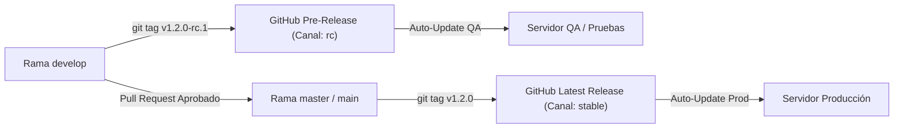

# 🚀 Release & Deployment Automation Playbooks

Repositorio central de arquitectura, estándares, flujos CI/CD (GitHub Actions) y scripts de automatización para el control de versiones por **Release Tags (`Stable` & `RC`)**, trazabilidad de despliegues (`Deployment ID` / `release-manifest.json`) y actualización automatizada en múltiples tipos de infraestructura.

---

## 📂 Estructura por Categorías

| Categoría | Carpeta | Casos de Uso | Estrategia de Despliegue y Auto-Update |
| :--- | :--- | :--- | :--- |
| **01. Estándar de Versionamiento y Tags** | [`01-versioning-strategy/`](./01-versioning-strategy/README.md) | Todos los proyectos | SemVer (`vX.Y.Z`), Release Candidates (`vX.Y.Z-rc.N`), `release-manifest.json` y flujo `develop` $\rightarrow$ `master`. |
| **02. Servicios de Windows (.NET Workers)** | [`02-windows-services/`](./02-windows-services/README.md) | `.NET Worker Service`, integraciones SAP B1 / ERP, demonios on-premise | GitHub Releases + Gestor PowerShell (`Manage-Service.ps1`) con autodetección `Win32_Service`, preservación de `config.json`, `rollback` y Tarea Programada (`SYSTEM`). |
| **03. Aplicaciones Web y APIs (Backend / Fullstack)** | [`03-web-apps-and-apis/`](./03-web-apps-and-apis/README.md) | APIs en Laravel/PHP, Node.js, .NET Web API, SPAs (React/Next/Vue) | Despliegue Zero-Downtime por Symlinks (`releases/<tag>` $\rightarrow$ `current`), endpoint `/api/version` y Webhook/Cron puller por canal (`stable`/`rc`). |
| **04. Contenedores Docker y Cloud / VPS** | [`04-docker-and-containers/`](./04-docker-and-containers/README.md) | Microservicios, Docker Compose, GHCR (`ghcr.io`), Kubernetes | Tags de imagen inmutables (`:v1.2.0`, `:v1.2.0-rc.1`), labels OCI de trazabilidad y actualización automática por canal. |
| **05. Herramientas CLI, Scripts y Cron Jobs** | [`05-cli-and-cron-jobs/`](./05-cli-and-cron-jobs/README.md) | Utilidades de consola, sincronizadores por lotes, ETLs | Binarios autocontenidos (Single-File) con auto-actualizador integrado (`--self-update`). |

---

## 🎯 Principios Fundamentales del Sistema

### 1. Dos Canales Oficiales Basados en Git Tags
En lugar de desplegar commits sueltos difíciles de auditar, **todo despliegue responde a un Tag de Git**:



- **Canal `rc` (`vX.Y.Z-rc.N`):**
  - Se etiqueta desde `develop`.
  - GitHub Actions lo publica automáticamente con `prerelease: true`.
  - Genera un `Deployment ID` con prefijo `RC-` (ej. `RC-v3.0.0-rc.1-ab5649f-20261018-122500`).
  - Los servidores de **Producción lo ignoran por completo**, mientras que los servidores de **Pruebas/QA** suscritos al canal `rc` lo descargan e instalan automáticamente.
- **Canal `stable` (`vX.Y.Z`):**
  - Se etiqueta desde `master` / `main` una vez aprobado el PR.
  - GitHub Actions lo publica como `Latest Release`.
  - Genera un `Deployment ID` con prefijo `REL-` (ej. `REL-v3.0.0-972dbe4-20261018-140000`).
  - Los servidores suscritos al canal `stable` se actualizan automáticamente.

---

### 2. El Contrato Universal: `release-manifest.json`
Sin importar si el proyecto es un Servicio de Windows en C#, una API en Laravel/Node o un Frontend en React, todo artefacto compilado incluye en su raíz un archivo `release-manifest.json`:

```json
{
  "appName": "WorkerFE",
  "releaseTag": "v3.0.0-rc.2",
  "channel": "rc",
  "deploymentId": "RC-v3.0.0-rc.2-46a4fdb-20261018-123345",
  "commitSha": "46a4fdb",
  "publishedAtUtc": "2026-10-18T12:33:45Z",
  "installedAtLocal": "2026-10-18 06:35:10"
}
```

Esto permite responder en menos de 2 segundos en cualquier servidor o aplicación:
1. **¿Qué versión exacta está corriendo?** (`releaseTag` + `deploymentId`)
2. **¿A qué commit corresponde?** (`commitSha`)
3. **¿Es una versión de pruebas (`rc`) o estable (`stable`)?** (`channel`)
4. **¿Cuándo se compiló y cuándo se instaló en este servidor?** (`publishedAtUtc` / `installedAtLocal`)
5. **¿Está al día con GitHub Releases en su canal?**

---

### 3. Reglas de Oro de Seguridad en Despliegues
1. **Nunca empaquetar secretos ni configuraciones locales en el artefacto del Release:** Archivos como `config.json`, `.env` o `appsettings.Production.json` se eliminan explícitamente durante el paso de `publish` en CI/CD y se excluyen al descomprimir en el servidor destino.
2. **Respaldo previo obligatorio (`Backup-Before-Deploy`):** Antes de detener un servicio o cambiar un symlink, el actualizador comprime o conserva la versión anterior para permitir un **`rollback` en un solo comando**.
3. **Bitácora local inmutable (`deployments-history.log`):** Cada actualización o rollback deja una línea de auditoría en el servidor indicando de qué `Deployment ID` a qué `Deployment ID` pasó, en qué fecha y bajo qué canal.
4. **Tokens con privilegios mínimos:** Los servidores que descargan artefactos desde repositorios privados utilizan un **GitHub Fine-Grained Personal Access Token** limitado exclusivamente al repositorio correspondiente con permiso único `Contents: Read-only`.

---

## 🛠️ Cómo Usar Este Repositorio en un Proyecto Nuevo

1. **Elige la categoría de tu proyecto** en las carpetas numeradas (`02-windows-services`, `03-web-apps-and-apis`, `04-docker-and-containers`, `05-cli-and-cron-jobs`).
2. **Copia el workflow de GitHub Actions** (`release.yml`) a `.github/workflows/release.yml` de tu proyecto.
3. **Copia el script gestor/actualizador** (`Manage-Service.ps1` para Windows o `deploy-web.sh` para Linux/Web) a la carpeta `deploy/` de tu proyecto.
4. **Crea tu primer tag RC o Stable:**
   ```bash
   # Para pruebas desde develop:
   git tag -a v1.0.0-rc.1 -m "Release Candidate v1.0.0-rc.1"
   git push origin v1.0.0-rc.1

   # Para producción desde main/master:
   git tag -a v1.0.0 -m "Release v1.0.0"
   git push origin v1.0.0
   ```
